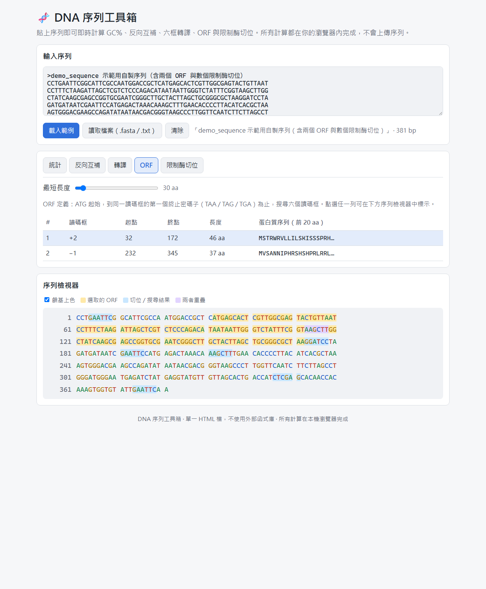

# DNA 序列工具箱 — 規格書

**線上使用：** https://alan47495.github.io/dna-toolbox/

## 1. 目標與使用者

- **使用者**：生命科學系學生（我自己），在修分子生物、生物資訊課或做實驗時，需要快速處理一段 DNA 序列
- **要解決的問題**：平常要做「算 GC%、反向互補、轉譯、找 ORF、找限制酶切位」時，得在好幾個不同網站之間切換，每個網站介面都不同，而且有些會把序列上傳到伺服器
- **目標**：一個打開就能用的單頁網頁，貼上序列後**所有結果即時更新**，全部在瀏覽器內計算，不上傳任何資料

## 2. 輸入

| 項目 | 規格 |
|---|---|
| 序列輸入框 | 可直接貼上序列；接受大小寫、空白、換行、數字（會自動清除）|
| FASTA 格式 | 以 `>` 開頭的標題行會被辨識並顯示為序列名稱，不計入序列 |
| RNA | 含 U 時自動轉成 T 並提示「已將 RNA 轉為 DNA」|
| 不合法字元 | A/T/G/C/N 以外的字母不計入，並顯示警告與數量 |
| 讀檔 | 可選擇本機 .fasta / .fa / .txt 檔案載入 |
| 範例按鈕 | 一鍵載入示範序列（自製，含多個 ORF 與限制酶切位）|
| 清除按鈕 | 清空輸入與所有結果 |

## 3. 功能與輸出

### 3.1 基本統計
- 序列長度（bp）
- A、T、G、C、N 各自的數量與百分比，以水平長條圖呈現
- GC 含量（%），計算方式：(G + C) / (A + T + G + C) × 100（N 不計入分母）
- 預估 Tm（熔解溫度），僅供引子參考：
  - 長度 < 14 nt：Wallace rule，Tm = 2 ×(A+T) + 4 ×(G+C)
  - 長度 ≥ 14 nt：Tm = 64.9 + 41 ×(G + C − 16.4) / N
  - 介面上註明使用的公式

### 3.2 序列轉換
- 反向（reverse）、互補（complement）、反向互補（reverse complement）三種結果
- 每個結果旁有「複製」按鈕，複製成功時顯示提示

### 3.3 轉譯（translation）
- 使用標準遺傳密碼表，終止密碼子顯示為 `*`
- 可切換六種讀碼框：+1、+2、+3（正股）與 −1、−2、−3（反向互補股）
- 含 N 的密碼子轉譯為 `X`
- 胺基酸序列每 10 個一組顯示，方便數位置

### 3.4 ORF 尋找
- ORF 定義：ATG 起始，到同一讀碼框第一個終止密碼子（TAA、TAG、TGA）為止，搜尋全部六個讀碼框
- 「最短長度」滑桿：只列出長度 ≥ 設定值的 ORF（預設 30 個胺基酸，可調 10–300）
- 結果表格欄位：讀碼框、起點、終點（以正股座標表示，1-based）、長度（aa）、蛋白質序列前 20 個字
- 依長度由長到短排序
- 點擊表格中的某一列 → 下方序列檢視器把該 ORF 標示出來，並捲動到該位置

### 3.5 限制酶切位與自訂序列搜尋
- 內建常用限制酶：EcoRI（GAATTC）、BamHI（GGATCC）、HindIII（AAGCTT）、XhoI（CTCGAG）、NotI（GCGGCCGC）、XbaI（TCTAGA）、PstI（CTGCAG）、SalI（GTCGAC）
- 以勾選方式選擇要找的酶；顯示每個酶的切位數量與位置
- 自訂 motif 輸入框：輸入任意 DNA 片段，搜尋正股與反向互補股
- 搜尋結果同樣可以在序列檢視器中標示

### 3.6 序列檢視器
- 每行 60 bp，每 10 bp 一組，行首顯示位置編號
- A/T/G/C 四種鹼基用不同顏色顯示（可關閉上色）
- 選取的 ORF 以底色標示；限制酶切位以另一種底色標示，滑鼠移上去顯示酶的名稱

## 4. 介面與設計

- 單一 `index.html`，CSS 與 JavaScript 都寫在檔案內，不依賴任何外部函式庫
- 版面：上方為輸入區，下方以分頁（tabs）切換「統計 / 轉換 / 轉譯 / ORF / 切位」，最底部為序列檢視器
- 全部使用繁體中文介面，專有名詞附英文
- 支援手機寬度（小螢幕時改為單欄）
- 支援系統深色模式
- 輸入時即時更新（加上 debounce，避免長序列時卡頓）

## 5. 非功能需求

- **隱私**：所有計算在瀏覽器內完成，不送出任何網路請求
- **效能**：10,000 bp 的序列，所有結果應在 1 秒內更新
- **正確性**：核心計算（反向互補、轉譯、ORF、GC%、切位搜尋）要寫成獨立函式，並用測試資料驗證

## 6. 不做的事（範圍外）

- 不做序列比對（BLAST、alignment）
- 不做引子設計的完整熱力學計算（Tm 只是粗估）
- 不支援蛋白質序列輸入

## 7. 驗收標準

1. 貼上範例序列，所有分頁都有正確結果
2. 反向互補、轉譯、ORF、切位位置與手算或已知答案一致（以自動化測試驗證）
3. 輸入含 FASTA 標題、空白、數字、小寫、U 的序列，都能正確清理
4. 在手機寬度下可以正常操作
5. 透過 GitHub Pages 公開網址可以正常開啟與操作

## 8. 開發紀錄：和 AI 反覆調整的過程

| 版本 | 做了什麼 | 發現的問題 | 怎麼修正 |
|---|---|---|---|
| 規格 v1 | 我選定「DNA 序列工具箱」，AI 依生科學生常用的操作提出功能清單，整理成本規格書（輸入、六項功能、介面、非功能需求、範圍外、驗收標準） | 原本只想到 GC% 與反向互補；討論後加入六框轉譯、ORF、限制酶，並明確寫出 ORF 定義、座標規則（正股、1-based）與 Tm 公式，避免實作時各自解讀 | 規格中寫死定義與公式，作為驗收依據 |
| 實作 v1 | 依規格完成單一 `index.html`；核心計算寫成不碰畫面的獨立函式 | — | — |
| 測試 1 | 用 node 跑 24 項自動化測試（FASTA／RNA／不合法字元清理、反向互補、密碼子表、六框轉譯、ORF 座標、雙股 motif、10 kb 效能），並用另一套寫法不同的 Python 程式交叉比對範例序列的結果 | 全部通過 | — |
| 測試 2 | 用無頭 Chrome 實際開啟網頁、自動點擊按鈕 | **網頁完全沒有反應**：範例序列字串裡夾了真正的換行字元，造成 JavaScript 語法錯誤，整個介面程式沒有執行。單獨測核心函式時抓不到這個錯 | 把換行改成 `\n` 跳脫字元；之後每次修改都重新在瀏覽器中檢查有無錯誤 |
| 測試 3 | 檢查手機寬度（375 px）的版面 | 整頁沒有溢出，但**序列檢視器固定每行 60 bp，手機上要左右滑動**才能看完一行，ORF 標示也不容易看 | 改成依畫面寬度自動決定每行 bp 數（10 的倍數，最多 60）；手機上每行 20 bp，視窗縮放時自動重排 |
| 使用者回饋 | 我實際操作上線的網頁後，覺得**文字太小**，請 AI 放大 | 序列和表格是等寬字，在筆電上看久了吃力 | 全站基準字級從 16 px 提高到 18 px（手機 17 px），序列檢視器與輸出區的字也放大；版面寬度從 1040 px 加到 1120 px |
| 測試 4 | 放大字後重新檢查手機版 | 字變大後，手機上 ORF 表格的欄位被擠成一字一行（「讀碼框」變成三行、「46 aa」斷行） | 表頭、數字欄、讀碼框欄設為不換行，表格在小螢幕上可左右滑動 |
| 驗收 | 重新跑全部測試與瀏覽器檢查：ORF 標示 141 bp（第 32–172 位）、限制酶切位數量與 Python 參考實作一致、無 JavaScript 錯誤 | — | — |

## 9. 規格與實作對照

| 規格項目 | 實作狀況 |
|---|---|
| FASTA、空白、數字、小寫、RNA 自動清理 | ✅ 並顯示 RNA 轉換與不合法字元提示 |
| 讀檔、範例、清除 | ✅ |
| 長度、鹼基組成長條圖、GC%、Tm（標示公式） | ✅ |
| 反向／互補／反向互補＋複製 | ✅ 複製後顯示提示 |
| 六框轉譯，`*` 與 `X` | ✅ |
| ORF：六框、最短長度滑桿、排序、點選標示並捲動 | ✅ |
| 8 種限制酶勾選、自訂 motif 雙股搜尋 | ✅ 正股以 (+)、反股以 (−)、迴文序列不加註 |
| 序列檢視器：位置編號、10 bp 分組、上色開關、ORF／切位標示、滑鼠提示酶名稱 | ✅ 每行 bp 數改為依螢幕寬度自動調整（規格原訂 60 bp） |
| 手機版、深色模式、不送出網路請求 | ✅ |
| （使用者回饋新增）較大的字級 | ✅ 18 px 基準字級 |
| 10 kb 在 1 秒內完成 | ✅（核心計算測試） |
